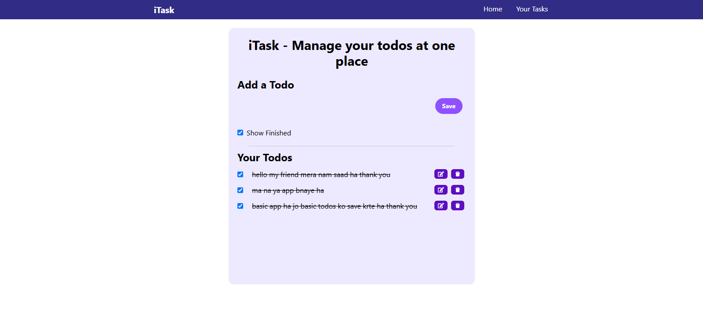

# iTask - Manage Your Todos in One Place

A clean, responsive to-do app built with React and Tailwind CSS. Add, edit, complete, and delete tasks, and filter out finished ones with a single click. Your todos are stored in the browser with `localStorage`.



## Features

- **Add todos** - the Save button stays disabled until the task is longer than 3 characters
- **Edit todos** - moves the task back into the input so you can change it and save again
- **Delete todos** - remove tasks you no longer need
- **Mark as complete** - checked tasks get a strikethrough
- **Show / hide finished** - toggle completed tasks with the "Show Finished" checkbox
- **Persistent storage** - todos are saved in `localStorage`
- **Responsive layout** - works on mobile and desktop

## Tech Stack

- [React](https://react.dev/) (with hooks: `useState`, `useEffect`)
- [Vite](https://vitejs.dev/)
- [Tailwind CSS](https://tailwindcss.com/)
- [React Icons](https://react-icons.github.io/react-icons/)
- [uuid](https://www.npmjs.com/package/uuid) for unique todo IDs

## Getting Started

### Prerequisites

- [Node.js](https://nodejs.org/) (v18 or later recommended)
- npm

### Installation

```bash
# Clone the repository
git clone https://github.com/Saad-Idrees-dev/iTask.git

# Go into the project folder
cd iTask

# Install dependencies
npm install

# Start the development server
npm run dev
```

Then open the local URL shown in your terminal (usually `http://localhost:5173`).

### Build for production

```bash
npm run build
npm run preview
```

## Project Structure

```
iTask/
├── src/
│   ├── components/
│   │   └── Navbar.jsx
│   ├── App.jsx
│   ├── main.jsx
│   └── index.css
├── index.html
├── package.json
└── vite.config.js
```

## How It Works

- Todos are stored in React state as objects: `{ id, todo, isCompleted }`.
- On first load, `useEffect` reads saved todos from `localStorage`.
- Each todo gets a unique ID from `uuid`, which is used for editing, deleting, and toggling.
- The "Show Finished" toggle filters the list without removing any data.

## Future Improvements

- Due dates and priority levels
- Categories or tags
- Drag and drop reordering
- Dark mode
- Backend with Node.js, Express, and MongoDB

## Author

**Saad** - [@Saad-Idrees-dev](https://github.com/Saad-Idrees-dev)

## License

This project is open source and available under the [MIT License](LICENSE).
